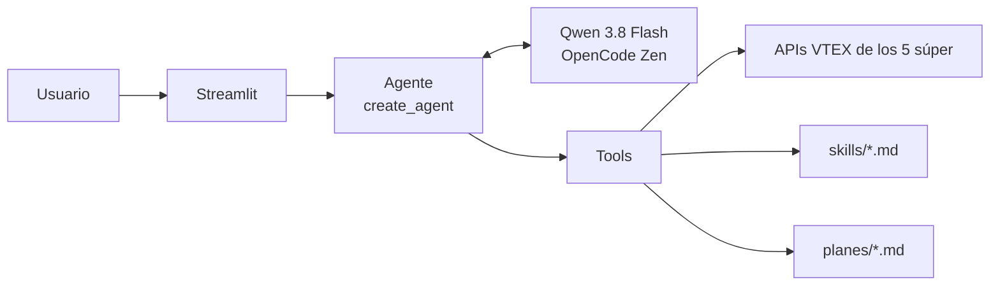

# 🛒 Super-agente

Agente de IA que arma compras de supermercado al menor precio. Busca en los catálogos online de
**Vea, Jumbo, Carrefour, ChangoMás y Día**, compara por precio unitario ($/L, $/kg) y entrega un
**plan de compra descargable**.

> Trabajo Integrador · Modelos de Lenguaje · UTN FRM · 2026

Ejemplo: *"Quiero hacer un asado para 4, máximo 2 supermercados"* → arma la lista con cantidades,
busca cada producto, calcula la compra más barata y genera el plan en un archivo `.md`.

## Instalación y ejecución

Requiere Python 3.12.

```bash
python3 -m venv .venv
source .venv/bin/activate          # Windows: .venv\Scripts\activate
pip install -r requirements.txt

cp .env.example .env               # completar OPENCODE_API_KEY
streamlit run app.py               # abre http://localhost:8501
```

Usamos **qwen3.8-flash** por [OpenCode Zen](https://opencode.ai) (por API hace falta OpenCode Go).
Elegimos este modelo porque soporta tool calling, devuelve su razonamiento (se muestra en la UI) y
tiene 1M de tokens de contexto. Con `PROVEEDOR` en el `.env` se puede usar Gemini (key gratis en
[Google AI Studio](https://aistudio.google.com/apikey)) o un modelo local con LM Studio.

> En Ubuntu, si `python3 -m venv` falla, instalá `python3.12-venv`.

## Cómo funciona



1. **Skills** (`skills/*.md`): conocimiento de dominio que el agente carga **solo cuando lo
   necesita** con `cargar_skill`. Por ejemplo: cuánta carne por persona, cuándo conviene ir a otro
   súper (si ahorra ≥ 10 %), qué marcas son económicas. Elegimos skills y no RAG porque son reglas
   y tablas cortas, no un corpus para buscar.
2. **Tools** (`tools.py`): `buscar_productos` consulta las APIs y filtra el ruido de la búsqueda
   por categoría (`rubro`: "vacio" no trae queso "al vacío"); `optimizar_compra` calcula la compra
   más barata con envases enteros; `generar_plan_compra` escribe el plan. Hay 9 en total; si una
   falla, devuelve el error como dato y el agente sigue.
3. **Los precios no pasan por el modelo**: las búsquedas se guardan en una cache y los cálculos
   se hacen en código, así el modelo no puede inventar ni copiar mal un monto.
4. **Memoria**: `SqliteSaver` guarda cada conversación (se pueden retomar desde la barra lateral) y
   un `SqliteStore` guarda las preferencias "para siempre" (ej: "sin marcas propias").
5. **UI**: muestra en vivo el razonamiento del modelo, cada tool con sus argumentos y un resumen
   del resultado, y el botón para descargar el plan.

## Limitaciones

- **Límites del proveedor**: una tarea usa entre 6 y 10 llamadas al modelo y el proveedor tiene
  límites de uso (429). Ante 429/5xx se reintenta con espera; si se agotan, la UI lo avisa.
- **Precios de la tienda online**: Vea devuelve precios de una sucursal de Córdoba; pueden diferir
  de la góndola.
- **Búsqueda por texto**: los catálogos traen ruido y nombran distinto los productos. Lo mitigan el
  filtro por rubro y el modelo, pero no es perfecto.
- **Modelos chicos** (ej: `gemini-3.5-flash-lite`) siguen peor las reglas de las skills.
