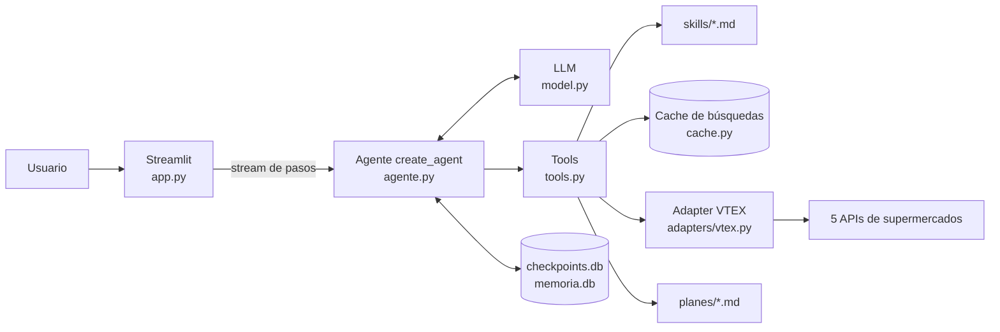

# 🛒 Super-agente

Agente de IA que arma compras de supermercado al menor precio. Consulta los catálogos online
de **Vea, Jumbo, Carrefour, ChangoMás y Día**, compara por **precio unitario** ($/L, $/kg,
$/un) y genera un **plan de compra descargable**: qué comprar en cada supermercado, total y
ahorro frente a las otras opciones.

> Trabajo Integrador · Modelos de Lenguaje · UTN FRM · 2026

**Ejemplo de tarea:** *"Quiero hacer un asado para 5 personas, máximo 2 supermercados"* →
el agente pasa la necesidad a una lista con cantidades, busca cada producto en los
supermercados, descarta los resultados que no corresponden, calcula la compra más barata
respetando el límite y entrega el plan como archivo `.md`.

---

## Instalación

Requisitos: **Python 3.12** y conexión a internet (las APIs de los supermercados son públicas).

```bash
git clone git@github.com:cuellojoaquinn/agente-de-supermercado.git
cd agente-de-supermercado

python3 -m venv .venv
source .venv/bin/activate          # Windows: .venv\Scripts\activate
pip install -r requirements.txt
```

> En Ubuntu/Debian, si `python3 -m venv` falla por `ensurepip`, instalá `python3-venv`
> (`sudo apt install python3.12-venv`).

## Configuración

```bash
cp .env.example .env
```

Completá en el `.env`:

| Variable | Para qué |
|---|---|
| `PROVEEDOR` | `gemini` (por defecto), `opencode` o `lmstudio` |
| `GOOGLE_API_KEY` | Key gratis de [Google AI Studio](https://aistudio.google.com/apikey) |
| `MODELO` | Modelo de Gemini (por defecto `gemini-3.5-flash`) |
| `OPENCODE_API_KEY`, `MODELO_OPENCODE` | Solo si `PROVEEDOR=opencode` |
| `MODELO_LOCAL`, `LMSTUDIO_URL` | Solo si `PROVEEDOR=lmstudio` |

El `.env` está en `.gitignore`: nunca se sube al repositorio.

## Ejecución

```bash
streamlit run app.py
```

Se abre en <http://localhost:8501>. Para probar el agente por consola, sin la UI:

```bash
python -m exploracion.probar_agente "tengo que comprar 2 L de leche y 1 kg de yerba"
```

Las bases `checkpoints.db` (conversaciones) y `memoria.db` (preferencias) se crean solas al
primer uso. Los planes generados quedan en `planes/`.

---

## Cómo funciona



Flujo típico de una tarea:

1. `cargar_skill("cantidades")`: pasa "asado para 5" a una lista con cantidades.
2. `elegir_supermercados`: si el usuario no dijo dónde buscar, la UI le muestra una ventana para elegir.
3. `buscar_productos` para cada ítem, en paralelo en los supermercados elegidos.
4. `descartar_productos`: saca el ruido de la búsqueda (ej: "asado" → cuchillos, mayonesa).
5. `cargar_skill("armar_carrito")` + `optimizar_compra`: compra mixta vs. un solo súper vs. máximo N.
6. `generar_plan_compra`: escribe el plan y la UI muestra el botón de descarga.

### Tools

| Tool | Qué hace | Externa / propia |
|---|---|---|
| `buscar_productos` | Busca en los supermercados (en paralelo), filtra ruido, ordena por precio unitario y guarda todo en la cache | API externa (VTEX) |
| `optimizar_compra` | Calcula la compra más barata de una lista: envases enteros, compra mixta, un solo súper, máximo N súper | Propia |
| `generar_plan_compra` | Escribe el plan final en `planes/*.md`; los montos los recalcula, no los escribe el modelo | Propia, archivo |
| `cargar_skill` | Carga una skill de `skills/` (conocimiento de dominio) | Propia, archivo |
| `elegir_supermercados` | Pausa el agente (`interrupt`) y le pregunta al usuario dónde buscar | Propia, UI |
| `descartar_productos` | Marca resultados que no corresponden, para que no se ofrezcan ni se usen al optimizar | Propia |
| `optimizar_carrito` | Revisa el carrito que armó el usuario y sugiere cambios más baratos | Propia |
| `guardar_preferencia` / `quitar_preferencia` | Marcas a evitar o preferidas, para esta conversación o para siempre | Propia, base de datos |

Todas devuelven los errores como dato (`{"error": ...}`) en vez de lanzar excepciones: un
supermercado caído o un nombre mal escrito no corta el flujo del agente.

**Los precios no pasan por el modelo.** `buscar_productos` guarda los resultados completos en
una cache y `optimizar_compra` / `generar_plan_compra` los leen de ahí. El modelo solo maneja
los textos de búsqueda, así no puede inventar ni copiar mal un precio.

### Conocimiento propio: skills bajo demanda (consigna 3.6 b)

| Skill | Contenido |
|---|---|
| `armar_carrito` | Cuándo conviene ir a otro supermercado (ahorro ≥ 10 %, máximo 3), envases según si el producto es perecedero, cómo presentar la compra |
| `marcas` | Primeras y segundas marcas por categoría, marcas propias de cada súper, productos equivalentes |
| `cantidades` | Porciones de referencia (asado, comidas, compra semanal) y términos de búsqueda probados |
| `leer_resultados` | Rarezas de los catálogos: venta por kilo, unidades no comparables, packs, descuentos, región |

**Por qué skills y no RAG:** el conocimiento que le falta al agente son **reglas y tablas
cortas** (qué marca es económica, cuántos gramos de carne por persona, cuándo no comparar dos
unidades). No es un corpus grande donde buscar por similitud. Cada skill ocupa entre 400 y 550
tokens y se carga **solo cuando hace falta**, una vez por conversación. Si estuvieran en el
system prompt, ocuparían contexto en cada llamada al modelo, aunque la pregunta fuera "¿cuánto
sale la leche?".

La descripción de `cargar_skill` lista las skills disponibles (tomadas del encabezado de cada
`.md`). Para agregar una, alcanza con crear `skills/<nombre>.md` con este formato:

```markdown
---
descripcion: Qué enseña y cuándo cargarla (el modelo la lee para decidir).
---
# Título
...
```

### Memoria

- **Corto plazo (consigna 3.3):** `SqliteSaver` como checkpointer, con un `thread_id` por
  conversación. Guarda los mensajes y el estado del agente (supermercados elegidos,
  descartados, preferencias de la conversación). Al ser SQLite, las conversaciones se pueden
  retomar desde la barra lateral después de reiniciar la app.
- **Largo plazo:** `SqliteStore` de LangGraph (`memoria.db`) para las preferencias "para
  siempre" (ej: "nunca marcas propias"), compartidas entre conversaciones.

### Middleware (consigna 3.7)

Solo `@dynamic_prompt`, el decorador de LangChain para escribir un middleware propio. Agrega al
system prompt las preferencias vigentes en cada llamada al modelo. **Por qué:** las preferencias
cambian durante la conversación (las guarda una tool) y tienen que llegar al modelo en la
siguiente llamada. Con un system prompt fijo habría que recrear el agente. La lógica es nuestra
(`prompt_con_preferencias` en `agente.py`); de LangChain solo usamos el punto de enganche.

### Interfaz y visibilidad del flujo (consignas 3.4 y 3.5)

- Chat en Streamlit con respuestas en markdown.
- **En streaming** (`stream_mode="updates"`), apenas termina cada paso: el razonamiento del
  modelo (🧠, en un desplegable aparte), cada tool con sus argumentos (🔧) y un resumen de su
  resultado (✅), en orden.
- Además: resultados de búsqueda con botón ➕ para armar un carrito, preferencias en la barra
  lateral, historial de conversaciones con buscador y plan descargable.

### Modelo y proveedor

**Gemini** (`gemini-3.5-flash`) por defecto, vía Google AI Studio. **Por qué:** soporta tool
calling, tiene tier gratuito y **devuelve el razonamiento** (`include_thoughts=True`), que la UI
muestra aparte del contenido final. Se configura con `thinking_level="low"` para bajar la
latencia de cada paso, y con `timeout=60` porque con 9 tools y razonamiento 15 s daban `504`.

Alternativas intercambiables con `PROVEEDOR`: **OpenCode Zen** (API compatible con OpenAI) y
**LM Studio** (local, sin cuotas). En ambos, `model.py` recupera el razonamiento del campo
`reasoning_content`, que el cliente de OpenAI descarta, para mostrarlo igual en la UI.

**Errores del proveedor:** 2 reintentos con espera ante 429/5xx, y si igual falla,
`mensaje_error()` lo muestra en la UI como un aviso claro (cuota diaria agotada, límite por
minuto, modelo saturado, LM Studio apagado), sin traceback.

---

## Limitaciones conocidas

- **Cuotas del tier gratuito:** Gemini da ~20 pedidos por día **por modelo**, y una tarea
  completa usa entre 6 y 10. En horas pico los modelos devuelven `503` (saturados). Para la
  demo conviene una key con facturación o cambiar de modelo. Los modelos gratis de OpenCode no
  se pueden usar por API.
- **Región:** los precios son de la tienda online. Vea devuelve precios de una sucursal de
  Córdoba (verificado con 8 códigos postales de Mendoza): pueden diferir de la góndola.
- **Búsqueda por texto difusa:** "asado" trae cuchillos y mayonesa "sabor asado". Lo mitigan
  el filtro por palabras clave (`_es_relevante`), `descartar_productos` y el aviso `revisar` de
  `optimizar_compra` (productos que necesitan 5 envases o más).
- **Catálogos distintos:** cada súper nombra distinto los cortes de carne ("tira de asado" solo
  existe en ChangoMás) y algunos no venden carne fresca online.
- **Datos del catálogo inconsistentes:** unidades mal cargadas, productos sin presentación, packs
  (x6) leídos como un solo envase, papel higiénico en metros o en rollos.
- **Cache de búsquedas en memoria del proceso:** se comparte entre conversaciones y se pierde al
  reiniciar (`optimizar_carrito` vuelve a buscar si hace falta).
- **Modelos chicos** (`flash-lite`) siguen peor las reglas de las skills: por ejemplo, a veces
  calculan totales a mano en vez de usar `optimizar_compra`.
- La tabla de marcas de `skills/marcas.md` es un criterio del grupo (precio y presencia en
  góndola), no una medida de calidad.

## Estructura del repositorio

```
├── app.py               # UI Streamlit: chat, streaming de pasos, carrito, historial, planes
├── agente.py            # create_agent + system prompt + middleware + checkpointer
├── model.py             # proveedores de LLM (Gemini, OpenCode, LM Studio)
├── tools.py             # las 9 tools
├── skills/              # conocimiento de dominio en markdown (cargar_skill)
├── preferencias.py      # preferencias del usuario (estado + Store de largo plazo)
├── cache.py             # cache de búsquedas (los precios no pasan por el modelo)
├── supermercados.py     # registro de supermercados
├── adapters/            # VTEXAdapter: búsqueda y normalización de productos
├── exploracion/         # scripts con los que exploramos las APIs (evidencia) y pruebas por consola
└── presentacion/        # presentación del integrador
```
